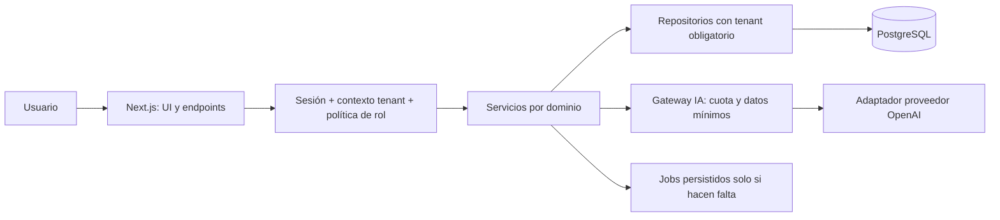

# Arquitectura propuesta

## Decisión estructural
Monolito modular Next.js con App Router, React y TypeScript estricto. Un despliegue web y PostgreSQL administrado en región próxima. Sin microservicios ni bus de eventos inicial. Ningún componente está instalado por LF-000. Versiones exactas, compatibilidad Node/Next/Better Auth/Drizzle y hosting se verifican y fijan en LF-001.

| Tecnología | Evaluación y límites |
|---|---|
| Next.js / React / TS | UI y backend juntos, contratos tipados y menor operación. Cuidar caché y límites server/client; TS no sustituye validación runtime. |
| Tailwind | Consistencia visual sin biblioteca pesada; requiere componentes accesibles y tokens compartidos. |
| PostgreSQL / Drizzle | Transacciones, claves compuestas, SQL visible y migraciones revisables. No usar filtros ORM como única barrera de tenant. |
| Better Auth | Evita implementar credenciales/sesiones desde cero. Integración y plugin de organización sujetos a prueba de compatibilidad; membresías deben tener una sola fuente de verdad. |
| Zod | Contratos de entradas, configuración y salidas IA. No reemplaza permisos ni restricciones SQL. |
| OpenAI con puerto propio | Adaptador reemplazable y pruebas con fake; costes/retención y disponibilidad dependen del proveedor. |
| Vitest / Playwright | Unidad e integración más recorridos reales; PostgreSQL real para aislamiento. |
| GitHub Actions | Validaciones reproducibles y revisión; secretos solo en jobs confiables, no PRs externos. |
| Hosting Next.js | Evaluar región, conexiones PostgreSQL, duración de requests, límites de archivos y jobs antes de elegir proveedor. |

## Módulos y dependencias
Propuesta de estructura futura: src/modules/{identity,organizations,leads,pipeline,interactions,followups,imports,analytics,ai,audit}; cada módulo con application, domain, infrastructure cuando aporten valor. src/app solo adapta HTTP/UI a servicios. src/shared contiene tipos de errores, contexto y utilidades estables, sin lógica comercial.

Identidad autentica; organizaciones produce ActorContext validado {userId, organizationId, role, requestId}. Nunca aceptar rol de cliente. Servicios usan políticas y repositorios exigen contexto; nadie consulta tablas de otro dominio directamente desde componentes. Analytics usa consultas revisadas; IA usa datos seleccionados vía servicios comerciales, no acceso SQL arbitrario. Audit se escribe en la misma transacción de cambios sensibles.

## Contratos de servidor y caché
Route Handlers para importación y operaciones IA; Server Actions pueden adaptar formularios con los mismos servicios, validación, CSRF y autorización. No exponer Drizzle ni claves al cliente. Formato de error: {code, message seguro, requestId, fieldErrors opcionales}; 401 sin sesión, 403 para capacidad prohibida, 404 para recurso inexistente/ajeno, 409 conflicto, 422 inválido, 429 cuota y 503 dependencia temporal. Sin stack traces públicos.

Respuestas autenticadas sin caché compartida; cualquier caché interna debe incluir tenant, actor/rol cuando aplique y versión de permisos, con invalidación al revocar membresía. Dashboard deriva de datos persistidos; no incorporar caché hasta medir necesidad.

## IA y ejecución larga
Puerto AiProvider con generate({action, content, constraints, signal}) → resultado estructurado validado, usage y providerRequestId. Modelos permitidos por configuración, prompts versionados, sin herramientas de escritura ni envío. No vincular reglas comerciales al SDK.

Comenzar síncrono acotado para IA y preview pequeño. Si límites de hosting/volumen lo requieren, jobs PostgreSQL con lease, intentos, estado y deduplicación; worker del mismo código, sin broker adicional. Job/outbox transaccional para evitar perder trabajo al confirmar. Nunca depender de trabajo en memoria tras responder HTTP. Decisión D-005 antes de implementar imports; prueba con fixture límite determina necesidad.
