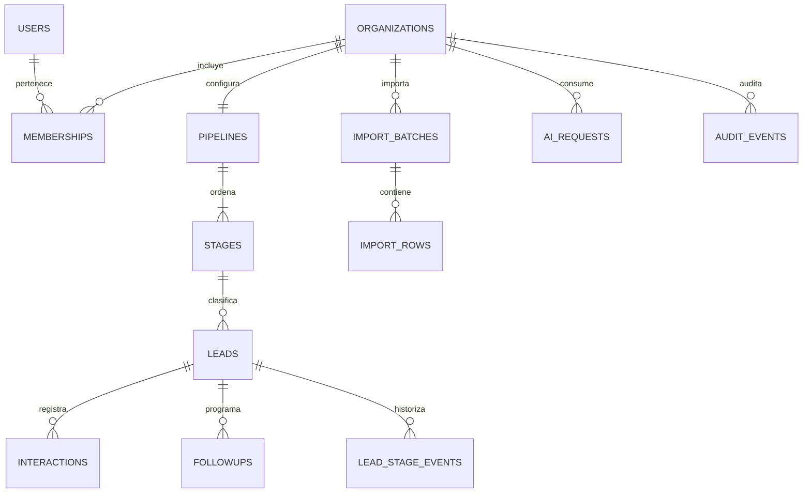

# Modelo de datos propuesto

UUID como PK, timestamptz en UTC; NOT NULL salvo campos marcados ?. Toda entidad comercial tiene organization_id NOT NULL y FK a organizations. Los nombres de tablas de autenticación son conceptuales: adaptar al esquema oficial de Better Auth sin duplicar membresías (D-002).

| Entidad / propietario | Claves, datos y restricciones |
|---|---|
| users / global identidad | id PK, email normalizado UNIQUE, email_verified, display_name, created_at. |
| accounts, sessions, verifications / identidad | Esquema oficial Better Auth; user_id FK cuando aplique; tokens protegidos según librería, expiración y revocación. Sin organización propietaria; no contienen datos CRM. |
| organizations / propia | id PK, slug UNIQUE, name, timezone IANA, created_at, deletion_requested_at?. |
| memberships / organización | id PK, organization_id FK, user_id FK, role CHECK owner/admin/sales; UNIQUE(organization_id,user_id). Usuarios asignados se referencian con esta pareja. |
| invitations / organización | id PK, organization_id FK, email, role, token_digest UNIQUE, expires_at, accepted_at?, invited_by. No permitir invitación owner sin transferencia autorizada. |
| pipelines / organización | id PK, organization_id FK UNIQUE (uno por tenant MVP), name; UNIQUE(organization_id,id). |
| stages / organización | id PK, organization_id, pipeline_id, name, position, kind CHECK open/won/lost, active; UNIQUE(organization_id,id), UNIQUE(organization_id,pipeline_id,position). FK compuesta al pipeline. |
| leads / organización | id PK, organization_id, stage_id, assigned_user_id?, name, email?, email_normalized?, phone_e164?, source?, version, archived_at?, created_at, updated_at. UNIQUE(organization_id,id); FK compuesta a stage y membership. version para concurrencia optimista. |
| lead_stage_events / organización | id PK, organization_id, lead_id, from_stage_id?, to_stage_id, actor_user_id, happened_at; FKs compuestas al lead/etapas/membresía. Solo append. |
| interactions / organización | id PK, organization_id, lead_id, author_user_id, kind, body, occurred_at, created_at, updated_at; FK compuesta al lead/autor. |
| followups / organización | id PK, organization_id, lead_id, assigned_user_id, due_at, status CHECK pending/completed/canceled, completed_at?, version. CHECK completed implica completed_at presente; FKs compuestas. |
| import_batches / organización | id PK, organization_id, created_by, idempotency_key, content_digest, status, mapping, counters, expires_at, created_at; UNIQUE(organization_id,idempotency_key). |
| import_rows / organización | id PK, organization_id, batch_id, row_number, sanitized_payload, status, error_code?, lead_id?; UNIQUE(organization_id,batch_id,row_number), FKs compuestas. Eliminar payload por retención. |
| ai_requests / organización | id PK, organization_id, user_id, lead_id?, action, prompt_version, model, status, idempotency_key, reserved_units, actual_units?, provider_request_id?, created_at; UNIQUE(organization_id,user_id,idempotency_key). No guardar prompt/respuesta crudos por defecto. |
| ai_usage_buckets / organización | organization_id + period_start PK, reserved_units, spent_units, limit_units; CHECK no negativos. Actualización atómica para impedir carreras de cuota. |
| audit_events / organización | id PK, organization_id, actor_user_id? (identificador histórico), action, entity_type, entity_id?, request_id, safe_metadata, created_at; solo append con rol app, sin cuerpos sensibles. |
| idempotency_records / organización | organization_id + actor_id + operation + key PK, request_hash, status, resource_id?, expires_at; conflicto si misma clave cambia payload. |
| jobs / organización, condicional D-005 | id PK, organization_id, kind, reference_id, dedupe_key, status, attempts, available_at, lease_until?; UNIQUE(organization_id,kind,dedupe_key). No payload sensible si referencia basta. |

## Aislamiento e integridad
Cada FK comercial usa (organization_id, referenced_id) hacia UNIQUE(organization_id,id); un UUID válido de otro tenant no satisface la FK. assigned_user_id referencia (organization_id,user_id) en memberships. Ninguna escritura toma organization_id libre del body: se deriva del contexto autorizado. Listados, agregaciones, jobs, exports e IA siguen la misma regla.

Defensa adicional propuesta: RLS para tablas tenant con USING y WITH CHECK sobre contexto transaction-local; rol runtime no propietario, sin BYPASSRLS, FORCE ROW LEVEL SECURITY cuando corresponda. Cada operación usa transacción y set_config local parametrizado; sin contexto se deniega todo. Pooling nunca conserva tenant entre transacciones. RLS protege frente a omisión de filtros, no frente a runtime comprometido capaz de cambiar contexto; la autorización de membresía sigue siendo obligatoria. Adaptador Auth y bootstrap de membresías usan rutas mínimas revisadas sin desactivar políticas globalmente. Validar viabilidad en LF-002.

Índices: leads(organization_id,stage_id,created_at,id), followups(organization_id,status,due_at), interactions(organization_id,lead_id,occurred_at), audit_events(organization_id,created_at), stage_events(organization_id,lead_id,happened_at). Buscar duplicados por índices parciales de email/teléfono no nulos. No imponer unicidad separada de email y teléfono hasta aprobar política: contactos compartidos son posibles; importación propone candidatos y serializa confirmación por organización para evitar carreras, además de idempotencia por fila.

## Ciclo de vida
Archivar prospectos no borra historial. Evitar CASCADE indiscriminado; RESTRICT para etapas y membresías referenciadas. Desactivar membresías preserva referencias históricas (agregar estado activo según esquema Auth acordado); la autorización exige activa. Transferencia de owner con bloqueo de organización para mantener al menos uno. Eliminación total del tenant mediante operación explícita autorizada y auditada, con purga ordenada, retención legal definida y eliminación eventual de backups conforme política. No soft-delete como sustituto de borrado por privacidad.
